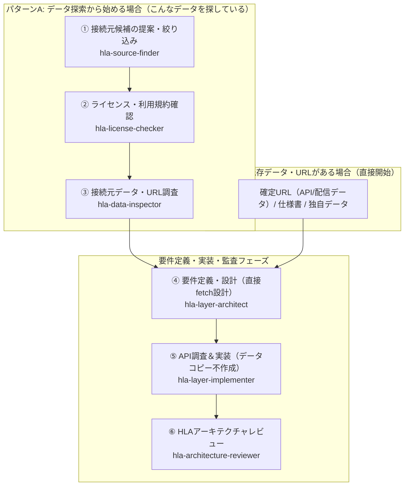

# HLA / HLMap Skills (Hyper-Layered Map 開発・仕様駆動ハーネス)

本リポジトリは、将来的な標準化を見据えた分散型Web地図技術 **HLA / HLMap** (Hyper-Layering Architecture) を正しく扱い、仕様駆動開発（Specification-Driven Development）を行うための **スキル（SKILLS）パッケージ** です。

---

## 1. 開発の背景と本スキルの目的

Leaflet、OpenLayers、Mapbox GL JS などの従来のWebGISライブラリは、**「単一の巨大なJavaScriptスクリプトが、すべてのレイヤーのデータフェッチ、描画、イベント処理、UIコントロールを集約・管理する」** という中央集権的（Centralized）なモノリシック構造を前提としています。

しかし、**HLA** の本質は、World Wide Webそのものと同じ **「分散指向（Decentralized）」** にあります。
HLAでは、レイヤーを単なる受動的データ（GeoJSONや画像タイル）として扱うのではなく、**各レイヤー自身が独立したHTML/JavaScript/CSSとSVG DOMを持つ自律的なWebアプリケーション「LaWA (Layers as WebApps)」** として捉えます。

### なぜアーキテクチャハーネスが必要なのか？
AIエージェントや開発者がWeb地図の実装を行う際、インターネット上の大半のコードがLeaflet/OpenLayersであるため、油断するとすぐに「親スクリプトで全レイヤーのGeoJSONをfetchして描画する」「命令的APIでレイヤーを追加する」というアンチパターンに逆戻りしてしまいます。

本スキルは、**強力なアーキテクチャハーネス（思考防止ガードレール）** を提供し、Leaflet/OpenLayersのようなモノリシックな設計に陥ることを物理的・論理的に防止し、HLA本来の分散型仕様に準拠した堅牢な開発を実現させます。

---

## 2. コア概念とアーキテクチャ重要原則

### ① 分散指向と完全カプセル化（Decentralized & Encapsulation）
- 地図コンテンツは、URLによってハイパーリンクされた独立リソースの集合体です。
- LeafletやOpenLayersのような中央集権型（親ビューア側が全データ・全レイヤーを一括管理する構造）を完全に排除し、データ処理・描画・UIをレイヤー（S-LaWA）単位でカプセル化します。
- GIS専用サーバー（GeoServer, PostGIS等）を必要とせず、静的ファイルホスティング（GitHub Pages, S3, CDN等）のみで完全なWebGISが動作します。

### ② データの非複製原則（No Data Copy / LaWAによる直接fetch）
- **HLAにおいて極めて重要な原則は、「データを手元にダウンロード（DL）するのではなく、LaWAで直接fetchし、データのコピーを作成しない」ことです。**
- 従来のGISのようにデータを手元へダウンロードしてローカル保存・再配置（コピーの作成）を行うと、元データの更新に追従できず陳腐化し、再配布禁止などのライセンス抵触リスクも生じます。
- HLAでは、元データ提供元のURLから各LaWA自身が直接 `fetch()` を行い、メモリ上で動的に描画（オンザフライ処理）します。これにより、データコピーを一切作成せず、常に最新かつ正確なデータを表示します。

### ③ レイヤー内カプセル化の許容（`appLayer` 等）
- `appLayer` 等を用いてLeafletを重ね合わせる構成や、やむを得ずローカル検証用データをS-LaWA内でパース・展開して表示する構成であっても、**当該レイヤーの境界内にカプセル化されており、親ビューアや他レイヤーを侵食していなければHLA準拠として許容**されます。

### ④ HLAコア機能との責務分担
- レイヤーの表示/非表示切り替え、非アクティブ化、アンロード（破棄）、ズーム範囲による表示制御（`visible-min-zoom` / `visible-max-zoom`）は**HLAのコア機能が制御する**前提とします。レイヤー側でコアのライフサイクル制御を再発明・阻害してはなりません。

### ⑤ Container.svg による宣言的マニフェスト
- 親コンテナ（`Container.svg`）は全知全能のコントローラーではなく、**「空間参照系 (CRS) の合意」** と **「パン・ズームイベント (`zoomPanMap`) の同期」** のみを担当する調停コンポジタです。
- レイヤーの構成は `<animation xlink:href="..." />` によって宣言的に行われます。

---

## 3. スキル構成とワークフロー（全6スキル連携）

本リポジトリには、包括的な開発を支援するマスター統合スキル **`hl-layer-creator`** に加え、段階的開発パイプラインを担う **6つの HLA 専門スキル**（`hla-*`）が整備されています。

### 段階的なワークフロー（2つの進め方）



1. **「こんなデータを探している」という悩みがある場合**:
   1. **接続元候補の提案・絞り込み (`hla-source-finder`)**: 候補や調査キーワードを提案し一緒に絞り込む（手元にDLせずLaWAから直接fetchできる接続元を優先、外部無断アクセスは禁止、不明点は明示）。
   2. **ライセンス調査 (`hla-license-checker`)**: 使ってよいかの確認サポート、出典表記義務の整理（データコピーを作らないことによるライセンス上の優位性と確認点）。
   3. **接続元データの調査 (`hla-data-inspector`)**: URLの静的解析（非通信）およびデータ構造・座標系・LaWA直接fetch適性の確認。
   4. **要件定義・設計 (`hla-layer-architect`)**: レイヤー構成、LaWAでの直接fetch設計（データコピー不作成）、S-LaWA UI、ズーム制御、出典欄の設計。
   5. **API調査＆実装 (`hla-layer-implementer`)**: 最新APIを参照しS-LaWA/Container.svgを実装（手元DLではなくLaWAで直接fetchし、データのコピーを作成しない）。
   6. **アーキテクチャレビュー (`hla-architecture-reviewer`)**: アンチパターン（データコピーの作成や中央集権化）の混入検査と是正案提示。

2. **具体的なデータ・URL・仕様が既にある場合**:
   - 接続元探しなどをスキップし、**要件定義・設計 (`hla-layer-architect`) から直接入る**ことが可能です。

---

### スキル一覧とディレクトリ構造

本リポジトリは、**完全な Markdown（`.md`）のみ** で構成されており、言語依存のスクリプトや静的サンプルコードを内包していません。

1. **`hla-source-finder` (接続元候補の提案・絞り込み)**:
   - 「こんなデータを探している」段階から候補や切り口を提案。手元DLではなくLaWAから直接fetch可能なエンドポイントを優先。自律アクセスは行わず、不確実な点は「分からない」と明示。
2. **`hla-license-checker` (ライセンス確認)**:
   - 勝手な「問題なし」断定をせず、利用規約の種別、出典・クレジット表記、共有制限など製作者の確認事項を整理。データコピーを作らないことによるライセンスリスク軽減を踏まえて確認。
3. **`hla-data-inspector` (接続元データ調査)**:
   - URL文字列の静的解析やデータ形式・座標系・規模・LaWA直接fetch適性の解析。自律的外部通信は禁止。
4. **`hla-layer-architect` (要件定義・設計)**:
   - HLA準拠のレイヤー設計（データを手元DLせずLaWAで直接fetchしコピーを作らない設計、コンテナ登録、S-LaWA UI・処理、ズーム範囲、出典表記欄の配置）。
5. **`hla-layer-implementer` (API調査＆実装)**:
   - 最新公式リソースを最優先検索・参照してコーディング。不変の最小リファレンスを保持。LaWA内で直接fetchしてオンザフライ描画し、データのコピーを作成しない実装を徹底。
6. **`hla-architecture-reviewer` (HLAアーキテクチャレビュー)**:
   - 分散地図システムの思想に準拠しているか、データコピー作成や中央集権化、越境アンチパターンをコードレベルで徹底検査。
7. **`hl-layer-creator` (マスター統合スキル)**:
   - 分散ハイパーレイヤリングアーキテクチャの体系的解説、仕様リファレンス、LaWA開発ガイド（直接fetchによる非複製原則）、ハーネス基準をまとめた総合マスタースキル。

```text
hl-layer-creator/
├── .agents/
│   ├── skills.json                     # Antigravity CLI スキルパス設定
│   └── skills/                         # 各スキルへのシンボリックリンク
│       ├── hla-source-finder -> ../../skills/hla-source-finder
│       ├── hla-license-checker -> ../../skills/hla-license-checker
│       ├── hla-data-inspector -> ../../skills/hla-data-inspector
│       ├── hla-layer-architect -> ../../skills/hla-layer-architect
│       ├── hla-layer-implementer -> ../../skills/hla-layer-implementer
│       ├── hla-architecture-reviewer -> ../../skills/hla-architecture-reviewer
│       └── hl-layer-creator -> ../../skills/hl-layer-creator
├── skills/
│   ├── hla-source-finder/              # 1. 接続元候補の提案・絞り込み
│   │   └── SKILL.md
│   ├── hla-license-checker/            # 2. ライセンス・利用規約確認
│   │   └── SKILL.md
│   ├── hla-data-inspector/             # 3. 接続元データ・URL調査
│   │   └── SKILL.md
│   ├── hla-layer-architect/            # 4. 要件定義・レイヤー設計
│   │   └── SKILL.md
│   ├── hla-layer-implementer/          # 5. API調査＆実装
│   │   ├── SKILL.md
│   │   └── references/
│   │       └── core-slawa-and-container.md # 不変の最小基本構造
│   ├── hla-architecture-reviewer/      # 6. HLAアーキテクチャレビュー
│   │   ├── SKILL.md
│   │   └── references/
│   │       └── hla-anti-patterns.md        # アンチパターン定義集
│   └── hl-layer-creator/                         # マスター統合スキル
│       ├── SKILL.md
│       └── references/
│           ├── architecture.md             # 分散アーキテクチャ解説
│           ├── specification.md            # HLA/CRS仕様
│           ├── lawa_guide.md               # LaWA開発ガイド
│           └── harness_and_anti_patterns.md# ハーネス基準
└── README.md
```

---

## 4. 配布・導入方針（サプライチェーンセキュリティとゼロ依存）

本スキル集は、npm や PyPI などの外部公開パッケージレジストリを介さず、**「Git ネイティブ（直接クローンまたは Git サブモジュール）」による配信・管理方針** を採用しています。

### なぜ Git ネイティブかつ Markdown のみなの？
1. **サプライチェーン攻撃リスクの排除**:
   公開パッケージレジストリ（npm/PyPI等）を介さないため、アカウント乗っ取りや悪意あるパッチ混入、タイポスクワッティング等のサプライチェーンリスクが原理的にゼロになります。
2. **純粋な Markdown（`.md`）設計**:
   スクリプトや実行バイナリを内包せず、AIエージェントへの指示・ルール（Markdown）のみで構成されているため、悪意あるコードが実行される危険がありません。
3. **最新リソースは公式から直接取得**:
   サンプルコードやテンプレートをスキル内に固定（凍結）せず、インターネット上の公式最新リポジトリから必要に応じてエージェント自身が取得・参照するため、コードの陳腐化が起きません。
4. **閉域網・完全ポータビリティ**:
   PythonやNode.js等の言語環境すら不要で、GitさえあればAntigravity、OpenCode、Claude Code、Cursor等のどの環境でも100%同一に動作します。

---

## 5. 導入・利用ガイド（2つの導入パターン）

### パターン A: ゼロからの新規開発（本リポジトリを直接クローン）

新規にHLA/HLAプロジェクトを立ち上げる場合は、本リポジトリをクローンしてワークスペースとして利用します。

```bash
# 1. リポジトリをクローンして移動
git clone https://github.com/<ユーザー名>/hl-layer-creator.git my-map-project
cd my-map-project

# 2. AIエージェント（Antigravity, OpenCode等）を起動
# -> .agents/skills.json により、全スキルが即座に認識されます
```

---

### パターン B: 途中まで進んでいる既存プロジェクトへの導入（Git サブモジュール方式）

既に開発が進んでいるプロジェクトに本スキル群を組み込み、そのプロジェクトのリポジトリへコミット＆プッシュする場合は、**Git サブモジュール（Git Submodule）** を利用します。

```bash
# 1. 既存プロジェクトのルートディレクトリに移動
cd /path/to/your-existing-project

# 2. 本リポジトリを .agents/svgmap-skills としてサブモジュール追加
git submodule add https://github.com/<ユーザー名>/hl-layer-creator.git .agents/hl-layer-creator-skills

# 3. .agents/skills.json を作成（または追記）してエージェントにスキルパスを登録
cat << 'EOF' > .agents/skills.json
{
  "entries": [
    {
      "path": ".agents/svgmap-skills/skills"
    }
  ]
}
EOF

# 4. 既存プロジェクトの変更をコミットして元のPJへプッシュ
git add .gitmodules .agents/svgmap-skills .agents/skills.json
git commit -m "feat(agents): HLA/SVGMap仕様駆動開発スキル群をサブモジュールとして追加"
git push origin <ブランチ名>
```

#### サブモジュールの最新化（スキルの更新追従）
```bash
git submodule update --remote .agents/svgmap-skills
git add .agents/svgmap-skills
git commit -m "chore(agents): hl-layer-creator を最新バージョンに更新"
git push origin <ブランチ名>
```

---

## 6. 公式リソース・サンプルコードの入手先（インターネット連携）

実装にあたり必要なサンプルコードや最新API情報は、以下の公式リソースを参照してください。

- **公式チュートリアル・サンプル集**: [svgmap/tutorials (GitHub)](https://github.com/svgmap/tutorials)
  - チュートリアル1〜4: 静的SVG海岸線・POI・タイリング・ビットマップ表示
  - チュートリアル5〜11: タイルピラミッド(OSM), GeoJSON, ベクトルタイル, メッシュデータ, 位置指定UI
- **公式LaWAコレクション**: [svgmap/svgmapAppLayers (GitHub)](https://github.com/svgmap/svgmapAppLayers)
  - オープンデータや各種テーマ別レイヤーの実装サンプル集
- **最新コアフレームワーク (ESM)**: [svgmap/svgmapjs (GitHub)](https://github.com/svgmap/svgmapjs)
  - 最新の `SVGMap.js`、`svgMapLayerLib.js`、`svgMapSandboxLayerLib.js`

---

## 7. コーディング規約と品質基準

本リポジトリ内のすべてのコードおよびドキュメントは、以下の原則を厳守しています：
- **ドキュメント言語**: 日本語による網羅的かつ平易な解説。
- **標準技術の遵守**: 独自のラッパーに頼らず、W3C標準（HTML, SVG, ECMAScript, CSS）のみを使用し、長期的なソフトウェア寿命を確保。
- **相対パスの徹底**: すべてのリソース参照（`data-src`, `xlink:href`, `data-controller`, `fetch`）に相対パスを使用し、静的ホスティングやローカル環境での完全な可搬性を維持。
- **エラー処理**: すべての非同期通信およびDOM操作に `try-catch` ブロックを配置し、堅牢性を確保。
- **命名規則**: 関数名および変数名にはキャメルケース（camelCase）を採用。

# 8. 注意事項

このSKILLSは作者の個人的な勉強のためAntigravityを用いて生成されたものです。
当SKILLSの利用、または利用不能によって生じた直接的・間接的・偶発的・特別・懲罰的または結果的な損害（データの喪失、業務の中断、利益の損失などを含みますが、これらに限定されません）について、作者は一切の責任を負いません。
