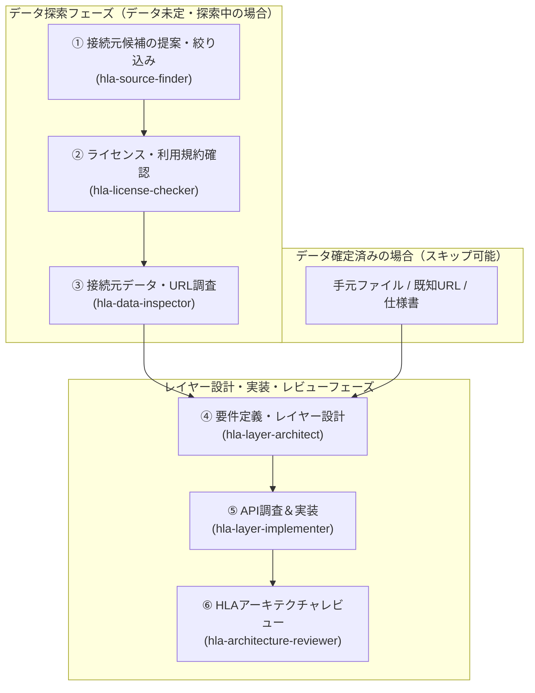

# HLA 仕様駆動開発・アーキテクチャハーネススキル

本スキルは、W3C/OGC標準化を背景とする分散型Web地図技術 **HLA**（およびその発展形である Hyper-Layering Architecture / HLMap）を正しく扱い、仕様に準拠したWeb地図アプリケーションおよびレイヤーを開発するための体系的ガイドです。

一般的なWeb地図ライブラリ（Leaflet、OpenLayers、Mapbox GL JSなど）に慣れた開発者やAIエージェントは、無意識のうちに「単一のJavaScriptスクリプトで地図全体と全レイヤーを集中的に統括・制御する」というモノリシックなアプローチを採用してしまいがちです。
しかし、HLAの本質は**Webそのものと同じ「分散指向（Decentralized）」**であり、レイヤーを単なる受動的データではなく独立したWebアプリケーションとして扱う**「LaWA (Layers as WebApps)」**にあります。

本スキルは、従来のWebGISの思考停止パターンを防止する**強力なアーキテクチャハーネス（防壁）**を効かせ、堅牢かつ持続可能な仕様駆動開発を実現させます。

---

## 1. コア設計思想：HLAと従来のWebGISの違い

HLAを扱う際は、以下の根本的な設計思想の対比を常に念頭に置かなければなりません。

| 観点 | 従来のWebGIS (Leaflet / OpenLayers) | HLA (Hyper-Layered Map) |
| :--- | :--- | :--- |
| **システム構造** | **集約的・モノリシック（Centralized）**<br>1つの巨大なJS空間がすべてを統括 | **分散型・フェデレーション（Decentralized）**<br>独立したWebリソースをURLで疎結合 |
| **データ保持・流通** | **手元ダウンロード・複製（Data Duplication）**<br>データをDL・ローカル保存して再配信 | **非複製・直接fetch（No Data Copy）**<br>手元にDLせずLaWAが元提供元から直接fetch |
| **レイヤーの定義** | **受動的データ（Passive Data）**<br>GeoJSONや画像タイルを中央ビューアがパース・描画 | **自律したWebアプリ（LaWA）**<br>各レイヤー自身がHTML/JS/SVGを持ち自律描画 |
| **コンテナの役割** | **全知全能の統括エンジン**<br>データ取得・UI表示・スタイル・イベントを一元管理 | **空間同期コンポジタ（Compositor）**<br>座標系の一致とパン・ズームイベントの同期のみ担当 |
| **コード結合度** | **密結合（Tight Coupling）**<br>レイヤー追加ごとに中央スクリプトがスパゲッティ化 | **疎結合（Loose Coupling）**<br>`Container.svg` の参照追加のみで独立動作 |
| **サーバー依存** | **GIS専用サーバー（GeoServer, DB等）**<br>複雑なバックエンドが必要な場合が多い | **Jamstack / 静的配信親和性**<br>静的ホスティング（GitHub Pages等）のみで完結可能 |

詳細なアーキテクチャ比較については、[アーキテクチャ解説書](./references/architecture.md) を参照してください。

---

## 2. アーキテクチャハーネス（思考防止ガードレール）

AIエージェントおよび開発者がLeaflet/OpenLayersのアンチパターンに陥らないよう、以下の**5大ハーネス原則**を強制します。

### 🚨 違反検出（即時リファクタリング対象）
1. ❌ **データの手元ダウンロードとコピー作成**:
   外部やオープンデータを手元にDLしてプロジェクト内に静的ファイルとして保存・抱え込むこと。データのコピーを作ってはならない。
2. ❌ **単一スクリプトでの全レイヤー制御**:
   `index.html` やメインのJavaScript内で、背景地図・主題図・POIデータ・UIダイアログのすべてをロード・描画・イベント処理しようとすること。
3. ❌ **レイヤーの生データ直接注入**:
   親ページ側で `fetch('data.geojson')` を実行し、親ページのロジックでSVGマップに要素を流し込むこと。
4. ❌ **命令的なレイヤー生成**:
   `Container.svg` を介さずに、JavaScriptの命令的API（`map.addLayer(...)` のような発想）のみでレイヤー群を構築しようとすること。
5. ❌ **座標系変換の自己流実装・Y軸反転の忘却**:
   SVGの座標系（下向き正）と地理座標系（北向き・上向き正）の差異を独自コードで場当たり的に計算し、`<globalCoordinateSystem>` の仕様を無視すること。
6. ❌ **レイヤー固有UIの親コンテナ同居**:
   特定の主題図レイヤーに属する凡例、フィルタースライダー、属性ポップアップなどを親コンテナのDOMに直接記述すること。

### ✅ 遵守すべきゴールデンパス
- **LaWAによる直接fetchとデータの非複製**:
  データを手元にダウンロードしてコピーを作成するのではなく、LaWA自身が提供元URLから直接 `fetch()` して動的に描画する。
- **`Container.svg` による宣言的構成**:
  地図全体の骨格、座標系、表示範囲、参照するレイヤー一覧は、必ず宣言的な `Container.svg` に定義する。
- **LaWAによる責務のカプセル化**:
  動的データ取得、固有UI、スタイリング、独自のインタラクションは、各レイヤー自身のWebアプリケーション（HTML/JS）に閉じ込める。
- **`svgMapLayerLib.js` を介した最小限の結合**:
  レイヤーと親フレームワークの通信は、`zoomPanMap` イベントの受信と、`svgImage`（レイヤーのSVG DOM）への描画、および `svgMap.refreshScreen()` の通知に限定する。

アンチパターンと正しい実装の対比は、[ハーネス＆アンチパターン集](./references/harness_and_anti_patterns.md) を参照してください。

---

## 3. 仕様駆動開発ワークフロー（6スキル連携モデル）

HLAレイヤーの開発は、ユーザーのデータ準備状況に応じて柔軟に分岐する段階的パイプラインに沿って進めます。



### ワークフローの2つの進め方

1. **「こんなデータを探している」という悩みがある場合**:
   - `hla-source-finder` で公的オープンデータやカタログから接続元候補を提案・絞り込み。
   - `hla-license-checker` で利用規約・出典表示義務・再配布制限を整理（分からない点は率直に明示）。
   - `hla-data-inspector` でURLの静的解析（非通信）およびデータ構造・座標系を確認。
   - `hla-layer-architect` でS-LaWA構成およびContainer.svgのズーム属性を設計。
   - `hla-layer-implementer` でWeb最新APIを参照しつつ実装（手元ファイル展開やLeaflet重ね合わせもレイヤー内カプセル化で対応）。
   - `hla-architecture-reviewer` でアンチパターンの混入をコードレベルで厳格に検査。

2. **具体的なデータ・URL・手元ファイル・仕様が既にある場合**:
   - 接続元探し（`hla-source-finder`）をスキップし、必要に応じてライセンス・データ検査を行った上で、**要件定義・設計（`hla-layer-architect`）から直接開始**する。

---

## 4. 専門スキル群の役割と責務

| スキル名 | 役割 | 主な責務と安全原則 |
| :--- | :--- | :--- |
| **`hla-source-finder`** | 接続元候補の提案・絞り込み | テーマに応じたオープンデータ等の切り口・検索キーワードを提示。不確実な点は「分からない」と明示し、無断スクレイピングや自律通信は行わない。 |
| **`hla-license-checker`** | ライセンス・利用規約確認 | 元データ・タイル・ライブラリの利用条件・出典表記義務・共有制限を整理。勝手な「問題なし」断定を禁止し、製作者の確認事項を促す。 |
| **`hla-data-inspector`** | 接続元データ・URL調査 | 提示されたURLの静的解析（非通信）およびサンプル・手元ファイルの形式・座標系・軸順を抽出。自律的な疎通通信は行わない。 |
| **`hla-layer-architect`** | 要件定義・設計 | S-LaWAとContainer.svgの分離、手元ファイル展開・Leaflet重ね合わせのカプセル化設計、`visible-min-zoom` によるズーム制御、出典表記欄の設計。 |
| **`hla-layer-implementer`** | API調査＆実装 | Web最新APIを最優先で検索・参照し、S-LaWA HTML/JS・レイヤーSVG・Container.svgを実装。手元ファイル展開・Leaflet併用時も境界を遵守。 |
| **`hla-architecture-reviewer`** | HLAアーキテクチャレビュー | 中央集権型ビューアへのロジック漏れ、サンドボックス越境（`parent.document`）、コア機能（表示・破棄・ズーム）の責務侵害を徹底検査。 |

---

## 5. 実装ステップと仕様詳細

### ステップ1: 要求分析とレイヤー分解
実装したい地図コンテンツを、独立したドメインごとにレイヤーへ分割します。
- **静的レイヤー**: 海岸線、行政境界、固定的なインフラ設備など、拡大縮小しても変化しない図形 → 純粋な `.svg` ファイル。
- **動的レイヤー (LaWA)**: タイルピラミッド（OSM、地理院地図）、GeoJSON/CSV配信データ、リアルタイムセンサー情報、レイヤー固有UI（凡例やスライダー）を持つもの → `レイヤー.svg` ＋ `コントローラー.html` ＋ `コントローラー.js`。

### ステップ2: `Container.svg` の宣言的定義
ルートマニフェストとなる `Container.svg` を作成します。
- ルートの `<svg>` 要素で初期 `viewBox` を指定。
- `<globalCoordinateSystem>` 要素で空間参照系（EPSG:4326等）と座標変換マトリクスを指定。
- 各レイヤーを `<animation>` 要素として宣言。

```xml
<?xml version="1.0" encoding="UTF-8"?>
<svg xmlns="http://www.w3.org/2000/svg" 
     xmlns:xlink="http://www.w3.org/1999/xlink"
     viewBox="139.6 -35.8 0.4 0.4">
    
    <!-- 空間参照系 (WGS 84 / CRS:84) と Y軸反転マトリクスの宣言 -->
    <globalCoordinateSystem srsName="http://purl.org/crs/84" transform="matrix(1,0,0,-1,0,0)" />

    <!-- 背景地図レイヤー（動的OSM） -->
    <animation xlink:href="layers/osm_basemap.svg" title="OpenStreetMap" class="basemap switch" visibility="visible" />

    <!-- 主題図レイヤー（GeoJSON避難所データ） -->
    <animation xlink:href="layers/shelters.svg" title="避難所情報" class="overlay" visibility="visible" />
</svg>
```
詳しい仕様は [HLA仕様リファレンス](./references/specification.md) を参照してください。

### ステップ3: 各レイヤーのSVG定義
動的レイヤー（LaWA）の場合、SVGルート要素の `data-controller` 属性でコントローラーHTMLを指定します。

```xml
<?xml version="1.0" encoding="UTF-8"?>
<svg xmlns="http://www.w3.org/2000/svg"
     xmlns:xlink="http://www.w3.org/1999/xlink"
     viewBox="139.6 -35.8 0.4 0.4"
     data-controller="shelters_controller.html#exec=appearOnLayerLoad">
    
    <globalCoordinateSystem srsName="http://purl.org/crs/84" transform="matrix(1,0,0,-1,0,0)" />
    
    <!-- 動的に要素が追加されるグループコンテナ -->
    <g id="shelterFeatureGroup" class="clickable"></g>
</svg>
```

### ステップ4: LaWAコントローラー（HTML/JS）の実装
各レイヤー固有の処理（データ取得、DOM生成、UI）をコントローラーにカプセル化します。
- `svgMapLayerLib.js`（サンドボックス時は `svgMapSandboxLayerLib.js`）を読み込む。
- `window.addEventListener("load", ...)` で初期化。
- `window.addEventListener("zoomPanMap", ...)` で地図移動・ズームに追従。
- `svgImage`（レイヤーのSVG Document）に対してDOMを生成・更新。
- 更新後に `svgMap.refreshScreen()` を呼び出す。

```javascript
// LaWA コントローラー実装例 (shelters_controller.js)
window.addEventListener("load", handleLayerLoad, false);

function handleLayerLoad() {
    try {
        // 地図移動・ズームイベントの監視を開始
        window.addEventListener("zoomPanMap", handleMapUpdate, false);
        // 初回描画の実行
        handleMapUpdate();
    } catch (error) {
        console.error("レイヤー初期化中にエラーが発生しました:", error);
    }
}

async function handleMapUpdate() {
    try {
        if (!window.svgMap || !window.svgImage) {
            return;
        }

        // 現在の地理的視域範囲を取得
        const geoViewBox = svgMap.getGeoViewBox();
        
        // レイヤー自身のSVG DOMグループを取得
        const groupElement = svgImage.getElementById("shelterFeatureGroup");
        if (!groupElement) {
            return;
        }

        // データの取得とSVG要素の構築（レイヤー内に閉じた責務）
        const response = await fetch("data/shelters.geojson");
        const geojsonData = await response.json();

        // 既存フィーチャーのクリア
        while (groupElement.firstChild) {
            groupElement.removeChild(groupElement.firstChild);
        }

        // GeoJSONフィーチャーの描画
        geojsonData.features.forEach((feature) => {
            const [longitude, latitude] = feature.geometry.coordinates;
            // 視域内かどうかの判定やSVG要素作成
            const circle = svgImage.createElementNS("http://www.w3.org/2000/svg", "circle");
            circle.setAttribute("cx", longitude);
            circle.setAttribute("cy", latitude);
            circle.setAttribute("r", "0.002");
            circle.setAttribute("fill", "#e74c3c");
            groupElement.appendChild(circle);
        });

        // 親フレームワークへ再描画を通知
        svgMap.refreshScreen();
    } catch (error) {
        console.error("フィーチャー描画中にエラーが発生しました:", error);
    }
}
```
詳細なLaWAの実装作法やS-LaWAについては、[LaWA開発ガイド](./references/lawa_guide.md) を参照してください。

### ステップ5: ホストHTMLでのマウント
親ページ（`index.html`）は、単に `Container.svg` をロードするマウントポイントに徹します。

```html
<!DOCTYPE html>
<html lang="ja">
<head>
    <meta charset="UTF-8">
    <meta name="viewport" content="width=device-width, initial-scale=1.0">
    <title>HLA アプリケーション</title>
    <style>
        html, body { margin: 0; padding: 0; width: 100%; height: 100%; overflow: hidden; }
        #mapcanvas { width: 100%; height: 100%; }
    </style>
</head>
<body>
    <!-- Container.svg をマウントする領域 -->
    <div id="mapcanvas" data-src="Container.svg"></div>

    <!-- 空間計算用ライブラリ -->
    <script src="https://unpkg.com/jsts@1.6.1/dist/jsts.min.js"></script>
    
    <!-- HLA コアフレームワーク (ESM) -->
    <script type="module">
        import { svgMap } from 'https://cdn.jsdelivr.net/gh/svgmap/svgmapjs@latest/SVGMapLv0.1_r18module.js';
        window.svgMap = svgMap;
    </script>
</body>
</html>
```

### ステップ6: HLAアーキテクチャレビューによる仕様・ハーネス検証
開発したファイル群がHLAの分散仕様およびハーネス規則を満たしているか、専用スキル `hla-architecture-reviewer` を呼び出してコードレビューを実行します。

```markdown
# 呼び出しプロンプト例
「実装したレイヤーコードがHLAアーキテクチャおよびカプセル化規則に準拠しているか、hla-architecture-reviewer でレビューしてください。」
```

---

## 6. 公式リソース・サンプルコードの参照先（インターネット連携）

本スキル集は陳腐化を防ぎ、サプライチェーン安全性を保つため、内部に固定コードを抱え込まず**純粋なMarkdown（`.md`）指示書のみ**で構成されています。
最新のサンプルコード、チュートリアル、実装例は、インターネット上の公式リポジトリから直接参照・取得してください。

- **公式チュートリアル・サンプル集**: [svgmap/tutorials (GitHub)](https://github.com/svgmap/tutorials)
  - チュートリアル1〜4: 静的SVG海岸線・POI・タイリング・ビットマップ表示
  - チュートリアル5〜11: タイルピラミッド(OSM), GeoJSON, ベクトルタイル, メッシュデータ, 位置指定UI
- **公式LaWAコレクション**: [svgmap/svgmapAppLayers (GitHub)](https://github.com/svgmap/svgmapAppLayers)
  - オープンデータや各種テーマ別レイヤーの実装サンプル集
- **最新コアフレームワーク (ESM)**: [svgmap/svgmapjs (GitHub)](https://github.com/svgmap/svgmapjs)
  - 最新の `SVGMap.js`、`svgMapLayerLib.js`、`svgMapSandboxLayerLib.js`
- **最小不変フォールバック仕様**: [core-slawa-and-container.md](../hla-layer-implementer/references/core-slawa-and-container.md)
  - オフライン時でも変わらないContainer.svgとS-LaWAの最小基本構造

---

## 7. まとめ

HLAを扱う際は、**「すべての自律性をレイヤー（LaWA）に与え、コンテナはただの空間的調停者に徹する」**という原則を絶対に崩さないでください。このハーネスを厳格に適用することで、中央集権的なGISプラットフォームに頼ることなく、Web標準だけで動く堅牢で拡張性の高い分散型WebGISを構築できます。
