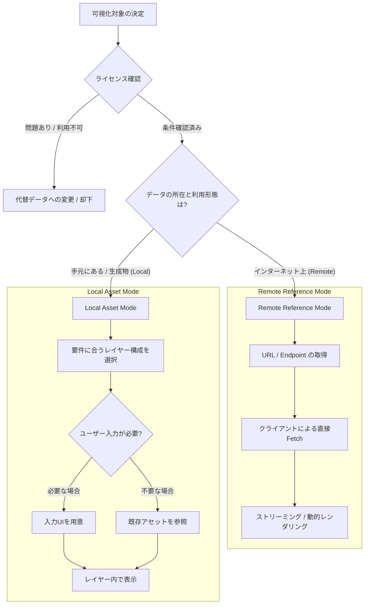

# データ供給方式と利用条件

本ドキュメントは、HLA（Hyper-Layering Architecture）において可視化データを統合する際の、データ出典に基づく意思決定フローと技術的実装方針を定義する。

## 1. 意思決定フロー (Decision Flow)

可視化対象が特定された後、利用条件とデータの所在を確認し、要件に合う供給方法を決める。ライセンス・規約が未確認なら適合性を断定せず、確認事項を残す。

## 2. 基本原則

### 2.1 利用条件の確認
実装方法を確定する前に、データ・サービス・ライブラリの利用条件、出典表示、キャッシュ、再配布の条件を確認する。条件が不明な場合は未確認と明記し、データの取得方法だけで利用許諾を判断しない。

### 2.2 取得・保存方式の選択
リモートデータは提供元への直接リクエストを候補にする。利用条件、CORS、可用性、応答量、更新頻度、オフライン要件によっては、キャッシュ、タイル化、変換済み素材、バックエンド経由など別方式が適切なこともある。ユーザー提供のローカルファイルやチュートリアル素材は、その利用目的・条件に応じて扱う。取得方式を一律に禁止・強制しない。

## 3. 技術的実装方針

### 3.1 リモートデータ
GeoJSON、CSV、タイル、地図サービスなどを扱う場合は、公式のアクセス方法、CORS、認証、利用制限を確認する。LaWAからの直接取得が要件に合う場合は、レイヤー内部で取得・変換・描画をカプセル化する。

### 3.2 ローカルデータ
ユーザー提供ファイルや既存の静的アセットを使う場合、入力、保存、パースをどの層が担うか決める。親ビューアにレイヤー固有処理を集約せず、必要な処理を対象レイヤー内に置く。ドラッグ＆ドロップや汎用AssetLoaderは、要件に含まれる場合に限り設計する。

## 4. アーキテクチャ上の責務分離

| コンポーネント | 責務 |
| :--- | :--- |
| **利用条件確認** | データ・サービス・ライブラリの規約と未確認事項を整理する。 |
| **データ供給方式の選択** | リモート、ローカル、キャッシュ等から要件に合う方式を選ぶ。 |
| **レイヤー実装** | データ取得・入力・変換・描画を、選択したレイヤー構成の責務内に置く。 |
