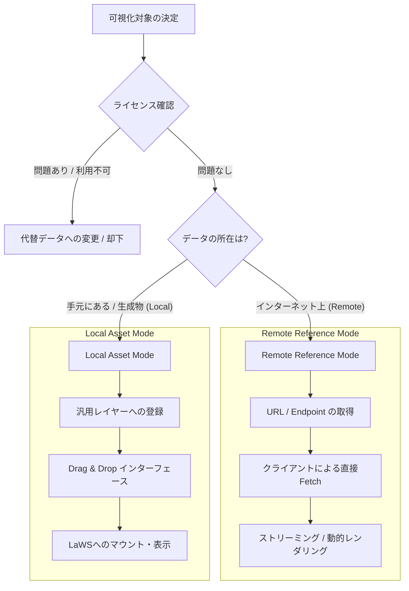

# データ供給およびライセンス・アーキテクチャ (Data Source & License Architecture)

本ドキュメントは、HLA（Hyper-Layering Architecture）において可視化データを統合する際の、データ出典に基づく意思決定フローと技術的実装方針を定義する。

## 1. 意思決定フロー (Decision Flow)

可視化対象が特定された後、以下のツリーに従ってデータの供給方法を決定する。

## 2. 基本原則

### 2.1 ライセンス優先の原則
データの技術的な取得方法を検討する前に、必ずライセンスの適合性を確認する。HLAの「非複製」の哲学は、法的なリスク（再配布禁止など）を回避するための重要な防衛策である。

### 2.2 非ダウンロード (No DL) 原則
インターネット上のデータについては、クライアント側でファイルを永続的に保存（DL）することを原則として禁止する。代わりに `fetch()` を用いてメモリ上に展開し、オンザフライ描画を行うことで、データの最新性を維持しつつライセンスを遵守する。

## 3. 技術的実装方針

### 3.1 Remote Data Provider (Fetchベース)
インターネット上のデータ（GeoJSON, CSV, Tiles等）を扱うための抽象化レイヤー。
- **動作**: クライアントが `fetch(url)` を実行し、取得したデータを直接SVG DOMへの変換処理へ渡す。
- **メリット**: サーバーサイドでの中間処理を排除でき、データの鮮度を最大化する。

### 3.2 Local Asset Layer (Drag & Drop対応)
何らかのツールやプロセスから出力された「手元にあるデータ」をLaWSに統合するための共通インターフェース。
- **Drag & Drop 対応**: ファイルがドロップされた際、そのファイル形式（画像、ベクター、構造化データ）を自動判別し、適切な `AssetLoader` にマッピングする。
- **汎用性**: 特定のツールへの依存を排除するため、LaWS側には「パスとメタデータ」のみを受け取る抽象的なドロップゾーンを提供する。

## 4. アーキテクチャ上の責務分離

| コンポーネント | 責務 |
| :--- | :--- |
| **License Checker** | データソースのURLや属性からライセンスを判定する（外部APIまたは定義済みリスト）。 |
| **Source Resolver** | データの所在（Remote/Local）を特定し、適切なProviderを選択する。 |
| **Fetch Provider** | Remote URLからの動的取得とメモリ内処理を担当。 |
| **Asset Loader** | Localファイルの読み込み、およびDrag & Drop時のパス解決を担当。 |
| **LaWS Renderer** | 提供されたデータ（Remote/Local問わず）をSVG DOMに描画する。 |
